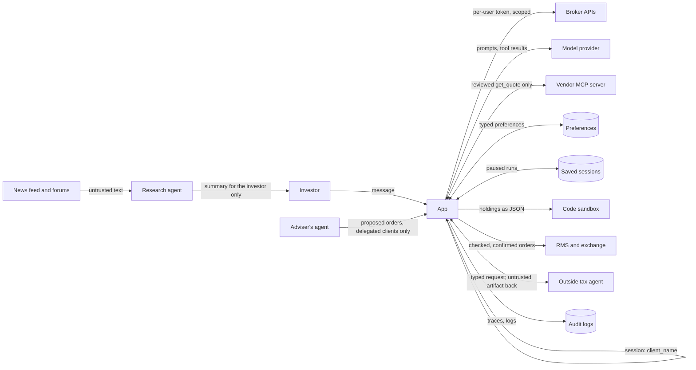

The last note ended with controls spread over many files, two frameworks, several stores and agents run by other companies. Each note looked at one risk at a time, and nobody has drawn the whole system.

## The idea

An **architecture review** looks at the system as a whole instead of one feature at a time. For an AI assistant it is the usual threat model, with one extra rule: **the model is not a trust boundary**. It sits inside the system, but it reads attacker text, so treat everything it produces like input from outside.

The review answers four questions:

1. What are the parts, and what data moves between them?
2. Where does trust change? Those are the **trust boundaries**.
3. For each risk, which control covers it, and is that control code or a request to the model?
4. What is left over, and how would we notice if it happened?

## Step 1: the data flow

The trust boundaries:

| Boundary | What crosses it | Direction of trust |
|---|---|---|
| Investor to app | Messages | Untrusted, except the session identity |
| App to model provider | Prompts, holdings, tool results | Our data leaves; the answers come back untrusted |
| App to vendor | Stock symbols; prices back | The vendor's descriptions and results are untrusted |
| News to research agent | Anyone's text | Fully untrusted |
| App to stores | Preferences, saved sessions, logs | Data at rest; each store needs its own access control |
| App to sandbox | Holdings in, text out | The code and its output are untrusted |
| App to outside agents | Minimum data out; artifacts back | The card, the artifact and any request for more data are untrusted; no broker token leaves |
| Outside agents to app | Proposed orders | Only for clients who delegated to that agent, and only with the client's own "yes" |
| App to RMS | Orders | Only after code checks and the investor's confirmation |

## Step 2: risk, control, and what kind of control

The most useful column is the last one. A **hard** control is code the model cannot talk its way past. A **soft** control asks the model to behave.

| Risk | Control | Note | Hard or soft |
|---|---|---|---|
| A wrong or invented order | `check_order`: symbol, quantity, limit only, value cap, price band | 2, 3 | Hard |
| Acting on another account | Identity from the session or a per-user token; no tool takes an account; no shared service account | 3, 12 | Hard |
| An agent with more powers than its job | Scopes checked before every tool call; tokens never in the model's context | 12 | Hard |
| Selling the same shares twice | `PENDING_SELLS` | 4 | Hard |
| An order the investor did not see | Confirmation built from Order fields, exact "yes" | 4 | Hard |
| Runaway loop or cost | `MAX_STEPS`, per-client rate limits and budgets | 4, 10 | Hard |
| Vendor changes its tools | Pinned fingerprints, fail closed, our own description | 6 | Hard |
| Holdings sent to the vendor | Forward only reviewed arguments | 6 | Hard |
| A forum post adds an order | No orders after news; research cannot act | 7, 9 | Hard |
| A forum post shapes the answer | Labelled as data; source shown; trusted sources ranked first | 7 | Soft |
| A poisoned memory | Typed preferences, confirmed, never loosened by chat | 8 | Hard |
| Research text reaches the order agent | No free-text handoff | 9 | Hard |
| Model-written code misbehaves | Sandbox; data, never powers | 9 | Hard |
| A fake or changed outside agent | Allowlist, signed and pinned agent cards, fail closed | 13 | Hard |
| An outside agent's answer places an order | Typed artifact, checked against holdings, shown as suggestions only | 13 | Hard |
| Instructions leak | Nothing secret in them | 10 | Hard, by design |
| Framework defaults leak data | Tracing settings, error handling, pinned version | 11 | Hard, if configured |
| Resuming someone else's session | Thread owned by the session; encrypted checkpoints | 11a | Hard |
| A known attack comes back | Eval suite with security cases at 5/5 | 5, 10 | A gate, not a control |

The soft row is the honest gap. Retrieval poisoning can still make the assistant give a wrong explanation, and nothing in code can judge whether an explanation is right. The defence there is to show the sources and let the investor judge.

## Step 3: cascading failures and fail-closed

Agents chain steps, so one failure can spread to the next step. Ask for each dependency what happens when it fails or lies:

| Dependency fails | Safe behaviour |
|---|---|
| Vendor tools changed | The app refuses to start (note 6) |
| Vendor down or slow | No price means no amount-based order; `check_order` uses our own feed |
| Our price feed down | `check_order` cannot check the band, so it must reject the order, not skip the check |
| Model provider down | The assistant says so; the normal order screens still work |
| Step limit reached | No order (note 4) |
| Checkpoint store down | Paused orders cannot resume, so they expire, never placed blind |
| Outside agent slow, down or changed | Timeout, a plain "not available" reply; a changed card is refused (note 13) |

One line in our own code fails open: `check_order` skips the price band when `get_quote` returns `None`. A review finds exactly this kind of line. The fix is to add a problem such as "no live price" instead of skipping the check.

## Step 4: watching for an agent that goes wrong

Every control above can have a bug, and a model update can change behaviour overnight. **Monitoring** spots an agent acting outside its job, using the audit logs:

- Orders for a stock the investor never named, or one they never held before.
- Any order or preference change in a request that read news. Code blocks these, so even one in the logs means a bug.
- A sudden rise in tool calls per request, or calls to tools an agent was not given.
- Many rejected orders from one client, which may be someone probing the limits.
- The vendor's tool fingerprint or an outside agent's card changing, even when the app refused it.
- An agent token used for a scope it was never granted, or after it was revoked.

Each alert needs an owner, and the team needs a **kill switch**: one setting that turns the assistant off while the normal trading app keeps working.

## OWASP risks in this note

The codes come from the [OWASP Top 10 for LLM Applications](A1.%20OWASP%20Top%2010%20for%20LLM%20Applications.md) and the [OWASP Top 10 for Agentic Applications](A2.%20OWASP%20Top%2010%20for%20Agentic%20Applications.md), both 2026 editions. The code in this note has not been run, so each example shows what would happen.

### ASI08: Cascading Failures

- **Example:** Our price feed is down, so `get_quote` returns `None`. Ravi types "buy 10 Reliance at 29000 limit". `check_order` skips the price band, the order is worth ₹2.9 lakh, under the ₹5 lakh cap, and it passes.
- **Issue:** One failed dependency quietly switches off a check. The check fails open.
- **Fix:** Every dependency fails closed: no live price adds the problem "no live price" and the order is rejected. This fix is not in the code yet.

### ASI10: Rogue Agents

- **Example:** After a model update, the assistant starts proposing orders for stocks the investor never named.
- **Issue:** Every control can have a bug, and prevention alone does not show you when one does.
- **Fix:** Monitoring on the audit logs, alerts with named owners, and a kill switch that turns the assistant off while the normal trading app keeps working.

## Problem and next step

**Problem:** the system is reviewed and the controls are mapped. But secure does not mean allowed. A broker is regulated, and orders produced by software are a regulated activity. Who is accountable when the assistant gets an order or an explanation wrong, and what evidence must the broker keep?

**Solution, in [15. Governance](15.%20Governance.md):** the rules that apply to an AI order assistant at an Indian broker, and the logs and evidence that show the controls work.
